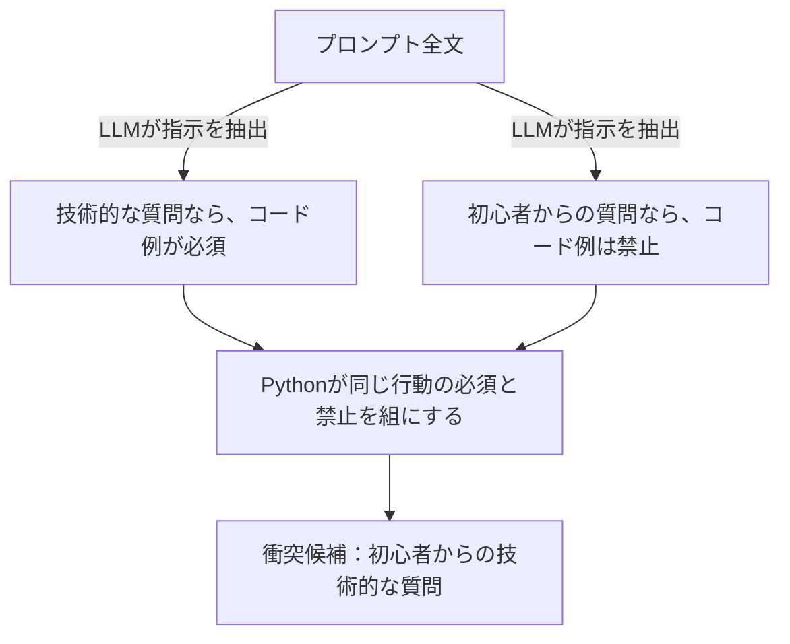

# プロンプト内の指示の矛盾検査

システムプロンプトに指示を加えたとき、既存の指示と同時に守れるかを調べるPoCです。

## 基本検査で分かること

基本の検査器が探すのは、**1回の応答で、同じ行動が必須にも禁止にもなる入力条件**です。たとえば次の2行は、それぞれ単独では守れます。

> 技術的な質問にはコード例を必ず添える。  
> 初心者からの質問にはコード例を添えない。

LLMは全文を読み、適用条件・明示された例外・行動・必須か禁止かを抽出してJSONに写します。行番号は根拠をたどるための目印です。1行に独立した指示が二つあればルールを分け、別の行に例外があれば該当するルールに結び付けます。[抽出指示](extraction.md)



Pythonは、この組に関係する条件の値を調べます。両方のルールが有効で、どちらの例外にも当たらない状況が一つでもあれば、その状況と衝突する原文を返します。この例では、コード例を付けても省いても、どちらかの指示に反します。「ただし初心者は除く」と1行目に明記すれば、この組の衝突は解消します。[入力例](examples/prompts/s1.md) · [抽出したルール](examples/extracted/s1.json)

「適切に助言する」のように判断基準がない指示や、「分析してから助言する」のように順序が必要な指示は、基本の形式では未変換として理由を残します。候補が見つからず未変換の箇所が残れば「未変換箇所あり」です。候補も未変換もない場合に言えるのは、抽出されたルールの範囲でこの種類の衝突が見つからなかったことです。

## 関連研究と本PoCの位置づけ

WIRE（Yanほか, 2026）は、同一ポリシー内の指示を論理的な制約に変換し、充足可能性検査で衝突候補を抽出する。さらに、両方の指示が適用される具体的な入力を作り、生成された応答やツール操作が各指示に従ったかを評価する。VeriSpec（Xieほか, 2026）は、文脈を保って仕様書から指示を抽出し、同じ権限レベルにある関連指示をまとめ、具体的な状況で両立するかをLLMで検証する。

本PoCでは、WIREの「衝突が成立する条件を示す」という考え方と、VeriSpecの文脈を踏まえた指示抽出を参照した。基本検査の対象は、架空の業務プロンプトからJSONに写した必須・禁止のルールである。Pythonで条件と例外を照合し、同じ行動を求める指示と禁じる指示が同時に有効になる状況を原文とともに示す。解釈が分かれる例は、問い合わせを固定し、抽出した読みごとに両立性を調べた。評価対象はこの抽出結果と機械判定であり、実際の応答でモデルがどちらの指示に従うかは測定していない。

[WIRE 原論文](https://arxiv.org/abs/2605.27784v1) · [VeriSpec 原論文](https://arxiv.org/abs/2610.01847) · [VeriSpec 著者実装](https://github.com/HIPREL-Group/VeriSpec)

## 検査する問いと手法

| 問い | 手法 |
| --- | --- |
| ある行動が同じ状況で必須にも禁止にもなるか | 適用条件と例外を有限の範囲で調べ、衝突する状況を示す。 |
| 一つの回答で全指示を満たせるか。文の読み方で結論は変わるか | 想定した入力と読みごとに、必須・禁止・選択肢を論理式にし、すべて満たす行動の組み合わせを探す。 |
| 回答の選択肢、文字数、手順の順序を同時に満たせるか | 手動で記述した制約を有限の範囲でまとめて検査する。両立しない場合は、どれか一つを外せば両立する制約の集合を示す。 |
| 予約後に原稿や承認の状態が変わっても、承認された版だけを公開できるか | 状態遷移のモデル検査で、公開条件を破る順序や公開に進めない状態を探す。Z3で上限のない版番号を扱い、[Leanの例](validation/formal/Approval.lean)では任意の有限な操作列で公開条件が保たれることを証明する。 |
| 以前の回答を再掲するとき、現在の本人確認では見せられない内容が混ざらないか | [Leanの再掲例](validation/formal/Disclosure.lean)で、原文どおりの再掲と表示禁止が衝突する例、および送信時に公開区分を照合する手順の安全条件を証明する。 |
| 入力の出所や承認に照らして、提案された操作を許可できるか | 利用者の依頼や資料の出所と、操作・対象・公開範囲・承認を許可ルールに照らす。 |

読み方の違いを含む入力例、公開手順のモデル、操作の許可ルールは、[検証ガイド](validation/README.md)にまとめています。

## 手元で試す

Python 3.10以上を使い、リポジトリのルートで次を実行します。同梱例の機械検査は保存済みの抽出JSONを使うため、API契約やネット接続は不要です。Windowsでは環境に応じて `python3` を `python` に読み替えてください。

```sh
# 衝突する指示と、その条件を表示
python3 -m checker examples/prompts/s1.md examples/extracted/s1.json

# 24件を期待判定と照合し、4件は別の抽出結果とも比較
python3 -m examples --repeat

# 制約全体と操作の権限を調べる例
python3 -m experiments constraints
python3 -m experiments authority

# 自動テスト
python3 -m unittest discover -s tests -v
```

結果をJSONで受け取るには、`checker` のコマンドに `--json` を付けます。[原文](examples/prompts)、[抽出JSON](examples/extracted)、[期待判定](examples/expected)は同じケースIDで参照できます。[抽出結果の比較例](examples/comparison)では、同じ行をルールに変換した結果と、未変換として記録した結果を確認できます。

Leanの証明は Lean 4.19.0 で個別に実行できます。[回答の再掲と情報開示](validation/README.md#leanで回答の再掲と情報開示を調べる) · [原稿の承認と公開](validation/README.md#leanで公開条件を証明する)

```sh
lean validation/formal/Disclosure.lean
lean validation/formal/Approval.lean
```


### 自分のプロンプトを調べる

1. 原文で、指示・例外・定義の各行に `[R01]` のような重複しないIDを付け、`prompt.md` として保存します。
2. [抽出指示](extraction.md)と原文をLLMの新規チャットに渡し、出力を `rules.json` として保存します。原文とルールが対応しているか、例外や未変換の指示がないかを確認します。
3. `python3 -m checker prompt.md rules.json` を実行します。
